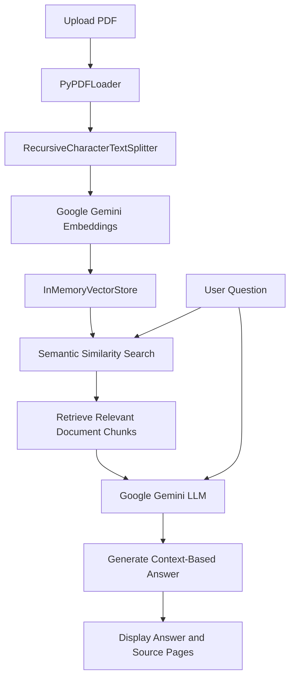

# 🧠 DocuMind AI

### Intelligent PDF Question Answering Using LangChain & RAG

DocuMind AI is a full-stack AI-powered web application that allows users to upload PDF documents and ask questions about their content using natural language.

The application uses **Retrieval-Augmented Generation (RAG)** with LangChain, Google Gemini, Gemini Embeddings, and an in-memory vector store to retrieve relevant document information and generate context-aware answers.

The main objective of this project is to demonstrate the practical implementation of RAG, semantic search, document processing, and LLM integration using Python and FastAPI.

---

## 🚀 Features

- **PDF Upload:** Upload and process PDF documents.
- **AI-Powered Question Answering:** Ask natural-language questions about uploaded PDFs.
- **Retrieval-Augmented Generation:** Generate answers using relevant document content rather than relying entirely on the LLM's general knowledge.
- **Semantic Search:** Retrieve relevant document chunks using vector similarity search.
- **Google Gemini Integration:** Generate context-aware answers using Gemini.
- **Source Page References:** Display the PDF page numbers associated with retrieved information.
- **Responsive Interface:** Clean, mobile-friendly React frontend.
- **REST API Backend:** FastAPI handles PDF processing and chat requests.
- **Temporary Document Storage:** Store document embeddings in memory without requiring an external database.

---

## 🛠️ Tech Stack

| Category | Technologies |
|----------|--------------|
| Frontend | React.js, Vite, CSS |
| Backend | Python, FastAPI |
| AI Framework | LangChain |
| LLM | Google Gemini |
| Embeddings | Google Gemini Embeddings |
| Vector Store | LangChain InMemoryVectorStore |
| PDF Processing | PyPDFLoader, pypdf |
| API Server | Uvicorn |
| Deployment | Vercel (Frontend), Render (Backend) |

---

## 🧠 RAG Architecture

DocuMind AI uses Retrieval-Augmented Generation to answer questions using uploaded PDF documents.



### How the RAG Pipeline Works

**1. Document Loading**

The uploaded PDF is processed using `PyPDFLoader`, which extracts text and page metadata.

**2. Text Chunking**

The extracted text is divided into smaller chunks using `RecursiveCharacterTextSplitter`.

Configuration:

- Chunk size: 1000
- Chunk overlap: 200

**3. Embedding Generation**

Each document chunk is converted into a numerical vector using Google's `gemini-embedding-001` model.

**4. Vector Storage**

Generated embeddings are stored temporarily using LangChain's `InMemoryVectorStore`.

**5. Semantic Retrieval**

When a user asks a question, the system performs similarity search and retrieves the four most relevant chunks.

**6. Answer Generation**

The retrieved chunks and user's question are passed to the Gemini LLM through a LangChain prompt.

**7. Response**

The application displays the generated answer along with retrieved source-page references.

---

## 📂 Project Structure

```text
DocuMind-AI/
│
├── backend/
│   ├── main.py
│   ├── rag.py
│   ├── requirements.txt
│   └── .env
│
├── frontend/
│   ├── public/
│   ├── src/
│   │   ├── App.jsx
│   │   ├── App.css
│   │   ├── index.css
│   │   └── main.jsx
│   ├── package.json
│   ├── package-lock.json
│   └── .env
│
├── .gitignore
└── README.md
```

**Note:** The `.env` files are created locally and must not be committed to GitHub.

---

## ⚙️ Installation and Setup

### Prerequisites

Make sure you have:

- Python installed
- Node.js and npm installed
- A Google Gemini API key
- Git installed

You can obtain a Gemini API key from [Google AI Studio](https://aistudio.google.com/apikey).

### 1. Clone the Repository

```bash
git clone https://github.com/YOUR_USERNAME/DocuMind-AI.git
cd DocuMind-AI
```

Replace `YOUR_USERNAME` with your GitHub username.

### 2. Backend Setup

Navigate to the backend directory:

```bash
cd backend
```

Create a Python virtual environment:

```bash
python -m venv .venv
```

Activate the environment on Windows PowerShell:

```powershell
.\.venv\Scripts\Activate.ps1
```

For macOS/Linux:

```bash
source .venv/bin/activate
```

Install backend dependencies:

```bash
python -m pip install -r requirements.txt
```

Create a `.env` file inside the backend directory:

```env
GOOGLE_API_KEY=your_gemini_api_key
FRONTEND_URL=http://localhost:5173
```

Replace `your_gemini_api_key` with your actual API key.

Start the FastAPI server:

```bash
python -m uvicorn main:app
```

Backend URL:

http://127.0.0.1:8000

FastAPI Swagger documentation:

http://127.0.0.1:8000/docs

### 3. Frontend Setup

Open another terminal and navigate to the frontend directory:

```bash
cd frontend
```

Install dependencies:

```bash
npm install
```

Create a `.env` file inside the frontend directory:

```env
VITE_API_URL=http://127.0.0.1:8000
```

Start the React development server:

```bash
npm run dev
```

Open:

http://localhost:5173

---

## 🔌 API Endpoints

### GET `/`

Checks whether the FastAPI backend is running.

### POST `/upload`

Uploads a PDF, extracts its content, generates embeddings, and stores the resulting vectors.

**Input:**

`multipart/form-data` with a file field named `file`.

**Example Response:**

```json
{
  "message": "PDF processed successfully!",
  "filename": "machine_learning.pdf",
  "document_id": "example-document-id",
  "total_pages": 5,
  "total_chunks": 18
}
```

### POST `/chat`

Answers questions using the uploaded PDF's indexed content.

**Request:**

```json
{
  "document_id": "example-document-id",
  "question": "What is supervised learning?"
}
```

**Example Response:**

```json
{
  "answer": "Supervised learning is a machine learning approach...",
  "sources": [1, 2]
}
```

The examples above are illustrative. Actual responses depend on the uploaded document.

---

## 🌐 Deployment

DocuMind AI is designed to support deployment with:

- **Frontend:** Vercel
- **Backend:** Render

### Backend Deployment on Render

Create a Python Web Service connected to the GitHub repository.

Configure:

| Setting | Value |
|---------|-------|
| Root Directory | `backend` |
| Build Command | `pip install -r requirements.txt` |
| Start Command | `uvicorn main:app --host 0.0.0.0 --port $PORT` |

Environment variables:

```env
GOOGLE_API_KEY=your_gemini_api_key
FRONTEND_URL=https://your-project.vercel.app
```

### Frontend Deployment on Vercel

Import the GitHub repository into Vercel.

Configure:

| Setting | Value |
|---------|-------|
| Framework | Vite |
| Root Directory | `frontend` |
| Build Command | `npm run build` |
| Output Directory | `dist` |

Environment variable:

```env
VITE_API_URL=https://your-backend.onrender.com
```

Use your actual deployment URLs instead of the placeholders.

Both services can be configured for automatic deployment when changes are pushed to the connected GitHub branch.

---

## 🔒 Security and Limitations

DocuMind AI is primarily a portfolio and educational project demonstrating RAG implementation.

- PDF file size is limited to 10 MB.
- PDF length is limited to 40 pages.
- Scanned or image-only PDFs are not supported without OCR.
- Document embeddings are stored temporarily in memory.
- Restarting the FastAPI server clears previously indexed documents.
- The application does not currently include user authentication.
- Documents are not isolated through authenticated user accounts.
- Google Gemini API requests are subject to model availability, usage limits, and quotas.
- AI-generated answers may occasionally be inaccurate.
- Source-page numbers indicate retrieved pages, not independently verified citations.

Avoid uploading confidential documents or using the current demo as a production document-management service.

---

## 🎯 Learning Outcomes

Through this project, I implemented and explored:

- Retrieval-Augmented Generation (RAG)
- LangChain document loaders and text splitters
- LLM integration using Google Gemini
- Text embeddings and semantic similarity search
- Vector storage and retrieval
- Prompt engineering for document-grounded responses
- REST API development using FastAPI
- React and FastAPI integration
- Environment-variable management
- Full-stack AI application development

---

## 🔮 Future Improvements

Possible future enhancements include:

- Persistent vector database storage
- More detailed source citations
- RAG retrieval and answer-quality evaluation
- Support for additional document formats
- User-specific document sessions
- Streaming AI responses

These are optional improvements and are not part of the current lightweight implementation.

---

## 📌 Project Purpose

DocuMind AI was developed to demonstrate how **Large Language Models (LLMs)** can be combined with **Retrieval-Augmented Generation (RAG)** to create practical AI applications that answer questions using external document knowledge.

The project emphasizes a clean implementation of LangChain, semantic retrieval, Gemini embeddings, Python, FastAPI, and React.

---

### ⭐ DocuMind AI — Turning PDFs into Interactive Knowledge